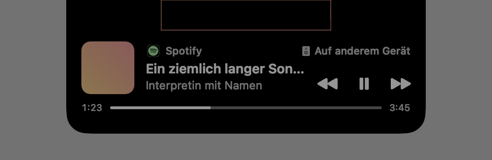
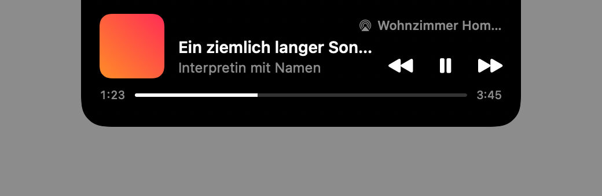

# Gnotchi

Eine Insel in der MacBook-Notch für macOS 27, gebaut im Stil des Systems. Läuft Musik oder ein
Video, zeigt Gnotchi in der Notch Cover und Pegel. Fährst du mit der Maus darüber, geht die Insel
auf und zeigt Titel, Interpret, App, Tasten und Fortschritt. Auf Bildschirmen ohne Notch erscheint
dieselbe Insel als Pille oben in der Mitte.

**Stand:** Version 0.1.0 in Arbeit, noch nicht veröffentlicht. **Download folgt mit Version
0.1.0.** Website gnotchi.mwlr.dev ist geplant. Kurzvorstellung: [docs/ONE-PAGER.md](docs/ONE-PAGER.md)

Voraussetzungen: macOS 27, Mac mit Apple-Chip. Kostenlos, Open Source (MIT).

| Klein in der Notch | Groß, Ton auf anderem Gerät |
|---|---|
|  |  |

| Groß als Pille (ohne Notch) | Groß, Ton über AirPlay |
|---|---|
|  |  |

Die Bilder rendern die Tests (`IslandViewRenderTests`) mit Platzhalter-Cover und erfundenem Titel
vor grauem Grund. Die rote Linie markiert die Hardware-Notch. Die beiden Bilder mit App-Symbol sind
etwas dunkler, das ist eine Eigenheit des Renderers, nicht der App.

Entstanden im Repo von [Seam](https://github.com/miwixyz/Seam) und am 18.10.2026 ausgelagert:
Seam hält die Bedienungshilfen-Freigabe, und ein Kindprozess könnte sie erben. Gnotchi hat diese
Freigabe nicht und fragt nie danach.

## Funktionen

- **Medien aus jeder Quelle**, die macOS als laufende Wiedergabe meldet: Spotify, Musik und
  Browser wie Safari, Edge oder Helium (auch Videos).
- **Klein und groß:** Klein zeigt die Insel Cover und Pegel neben der Notch. Groß zeigt sie Cover,
  App, Titel, Interpret, die Tasten Zurück, Wiedergabe/Pause und Weiter sowie einen dünnen
  Fortschrittsbalken mit Zeiten wie im Kontrollzentrum.
- **Spulen:** im Balken klicken oder ziehen, gespult wird beim Loslassen. In Spotify auch dann,
  wenn die Musik über Spotify Connect auf einem anderen Gerät läuft. Ohne Dauer (Livestream) ist
  der Balken gesperrt.
- **Welche App spielt:** Symbol und Name der Quell-App über dem Titel, klein ein Abzeichen am
  Cover. Der Name kommt aus der installierten App, nie von einer Website.
- **Wo die Musik spielt:** „Auf anderem Gerät“ (etwa Spotify Connect), bei AirPlay oder Bluetooth
  der Name des Geräts. Bei anderem Gerät und AirPlay zeigt die kleine Insel einen Lautsprecher
  statt des Pegels.
- **Aufklappen nach** einer wählbaren Verzögerung (Sofort, 0,3 s, 0,6 s, 1 s; ab Werk 0,6 s).
  Mit gedrückter Maustaste geht die Insel nicht auf, etwa wenn du ein Fenster an den oberen Rand
  ziehst.
- **Rechtsklick** (oder Ctrl-Klick) auf die Insel öffnet ein Menü mit „Einstellungen …“ und
  „Hilfe …“.
- **Zweite Notch-App:** Zeichnet eine andere App ebenfalls über die Notch (z. B. NotchNook), steht
  oben im Menü und in den Einstellungen ein Hinweis mit ihrem Namen.
- **Unaufdringlich:** Die Insel verschwindet 5 Sekunden nach dem Pausieren, und sie blendet sich
  auf einem Bildschirm aus, solange dort eine App im Vollbild läuft. Jeder Bildschirm hat seine
  eigene Insel.
- Menüleisten-Symbol mit Einstellungen, Hilfe, Update-Suche und Beenden. Einstellungen: „Musik in
  der Notch“, „Aufklappen nach“, „Bei Anmeldung starten“.

## Installieren

Download folgt mit Version 0.1.0. Ausgeliefert wird dann ein ZIP mit Developer-ID-Signatur, von
Apple notarisiert, über GitHub-Releases. Auspacken und nach *Programme* ziehen, kein Xcode nötig.

Wer im Terminal installiert, nimmt `ditto`, nicht `unzip`. `unzip` zerstört die Metadaten des
signierten Programms, macOS hält es dann für beschädigt:

```bash
ditto -x -k Gnotchi-0.1.0.zip . && mv Gnotchi.app /Applications/ && open /Applications/Gnotchi.app
```

## Aktualisieren

Gnotchi aktualisiert sich über [Sparkle](https://sparkle-project.org). Es fragt einmal, ob es
selbst nach Updates suchen darf. Ein gefundenes Update steht oben im Menü, ohne Mitteilung.
Gnotchi installiert nur Updates, die mit Michaels Schlüssel signiert sind. Auch die Update-Liste
(Appcast) selbst muss signiert sein.

## Berechtigungen und warum

| Was macOS fragt | Wann | Wozu |
|---|---|---|
| **Automation für Spotify** | beim ersten Spulen in Spotify | Spotify spult per AppleScript. Über Spotify Connect springt die Zeit sonst zurück (gemessen 18.10.2026). |
| **Automation für Musik** | nur, wenn der Rückfall greift (siehe unten) | Steuern und Titel lesen ohne den systemweiten Weg |
| **Anmeldeobjekt** | wenn du „Bei Anmeldung starten“ einschaltest und macOS eine Freigabe verlangt | Start nach dem Anmelden. Die Einstellungen zeigen dann „macOS wartet auf deine Freigabe“ mit einem Knopf dorthin. |

Was Gnotchi **nicht** braucht: keine Bedienungshilfen, keine Bildschirmaufnahme, kein Mikrofon.
Fürs Vollbild und für die Erkennung einer zweiten Notch-App liest es aus der Fensterliste nur
Ebene, Lage und Prozessnummer, keine Fenstertitel.

Widerrufen: Systemeinstellungen → Datenschutz & Sicherheit → Automation → Gnotchi.

## Datenschutz

- **Nichts verlässt den Mac** außer der Update-Prüfung (Sparkle, bei GitHub).
- Titel, Interpret und Cover bleiben im Arbeitsspeicher. Gnotchi speichert sie nicht, schreibt sie
  nicht ins Protokoll und lädt keine Cover-Adressen aus dem Netz. Ins Protokoll kommen nur
  Zustandswechsel und die Kennung der Quell-App.
- Gespeichert werden nur die Einstellungen, auf diesem Mac.
- Für „Wo die Musik spielt“ liest Gnotchi über Core Audio nur, **ob** eine App gerade Ton ausgibt,
  und vom Ausgabegerät Art und Namen. Es nimmt nichts auf und hört nichts mit. Der Pegel in der
  kleinen Insel ist eine Animation, kein Messwert.
- Keine echten Hördaten im Quellcode: ein Gate prüft das bei jedem Commit und Release
  ([G16](docs/SECURE-DESIGN.md)).

## So funktioniert es

Apple bietet keine öffentliche Schnittstelle für „was spielt gerade“ quer über alle Apps. Gnotchi
nutzt wie Boring Notch oder Cyclop den Medien-Adapter
[mediaremote-adapter](https://github.com/ungive/mediaremote-adapter): Der systemeigene
`/usr/bin/perl` lädt ein kleines Framework aus Gnotchis Programmpaket, das an Apples
`MediaRemote.framework` kommt und die Wiedergabe als Zeilenstrom meldet.

- Vor **jedem** Start prüft Gnotchi die Signatur des eigenen Programmpakets, samt Kennung und
  Team. Ist sie ungültig, startet der Adapter nicht.
- Perl startet ohne Shell, mit festen Argumenten und fester Umgebung.
- Der Strom gilt als nicht vertrauenswürdig, denn jede Website kann Titel setzen: Zeilen und Texte
  sind begrenzt, Steuer- und Richtungszeichen fliegen raus, Cover werden begrenzt dekodiert.
- **Rückfall:** Startet der Adapter nicht (Signatur, macOS sperrt den Zugriff, wiederholter
  Absturz), liest und steuert Gnotchi Spotify und Musik direkt per AppleScript. Andere Quellen
  zeigt es dann nicht.

Alle Entscheidungen mit Begründung: [docs/SECURE-DESIGN.md](docs/SECURE-DESIGN.md).

## Grenzen

- **Eine Quelle:** Gnotchi zeigt, was macOS gerade als aktuelle Wiedergabe führt. Spielen zwei
  Apps gleichzeitig, entscheidet macOS, welche es ist.
- **Apple kann den Perl-Weg schließen.** Dann bleibt der Rückfall für Spotify und Musik.
- **Nur eine Notch-App:** Zwei Apps über der Notch überdecken sich. Gnotchi meldet das, beenden
  musst du eine davon selbst.
- Ein maximiertes Fenster bei ausgeblendetem Dock hat auf Notch-Bildschirmen dieselbe Lage wie
  Vollbild. Die Insel blendet sich dann ebenfalls aus.

## Bauen und testen

```bash
make gen       # Projekt erzeugen (xcodegen), CHANGELOG ins Bundle spiegeln, Package.resolved einspielen
make build     # bauen, unsigniert
make test      # Tests (signiert, der Test-Host ist die App)
make lint      # Datenschutz-Gate + SwiftLint strikt (inkl. „keine Bedienungshilfen“, „Kindprozess nur im Adapter“)
make hooks     # einmal je Klon: Datenschutz-Gate vor jedem Commit
make dev       # Testversion mit Developer ID signiert unter /tmp starten (scripts/dev-signed.sh)
make install   # signierte Testfassung nach /Applications
make release   # notarisiertes ZIP, GitHub-Release, signierter Appcast
```

Voraussetzungen: macOS 27, Xcode, `xcodegen`, `swiftlint`. Der Adapter startet nur aus einem mit
Michaels Team signierten Programmpaket (`make dev`, `make install`). Ein unsignierter `make build`
zeigt deshalb höchstens Spotify und Musik über den Rückfall.

Bilder der Insel ohne App-Start: `TEST_RUNNER_GNOTCHI_RENDER_DIR=/tmp/gnotchi-render make test`
(absoluter Pfad).

## Aufbau

| Pfad | Was |
|---|---|
| `Gnotchi/App/GnotchiApp.swift` | Einstieg, Menüleiste, Fenster, Start und Stopp der Notch |
| `Gnotchi/Island/` | Insel: Panels je Bildschirm, Lage, Ansicht, Rechtsklick-Menü, zweite Notch-App |
| `Gnotchi/Media/MediaAdapter.swift` | Kindprozess `/usr/bin/perl` + Adapter, Neustart, Waisen |
| `Gnotchi/Media/NowPlayingInfo.swift` | Adapter-Zeile → bereinigter Wiedergabe-Zustand |
| `Gnotchi/Media/NowPlayingModel.swift` | Was die Insel zeigt, Steuerbefehle, Rückfall, Wiedergabeweg |
| `Gnotchi/Media/AppleScriptSource.swift` | Rückfall und Spotify-Spulen per AppleScript (feste Skripte) |
| `Gnotchi/Media/AudioRoute.swift` | Wiedergabeweg aus Core Audio, nur lesen |
| `Gnotchi/Media/BundleIntegrity.swift` | Signatur + Team des eigenen Programmpakets vor jedem Start |
| `Gnotchi/UI/` | Einstellungen, Menü, Hilfe-Fenster, Markdown-Darstellung |
| `Gnotchi/Resources/` | `HILFE.md`, `CHANGELOG.md` (Spiegel), Lizenzen, Schrift, Info.plist |
| `Vendor/mediaremote-adapter/` | eingespielter Adapter (BSD-3), siehe `VENDOR.md` |
| `scripts/` | Signieren, Release, Doku-Gate, Berechtigungs-Gate, Datenschutz-Gate |
| `.githooks/` | Pre-Commit-Hook (Datenschutz-Gate), eingeschaltet per `make hooks` |
| `docs/` | Sicherheitsentwurf, One-Pager, Bilder |
| `specs/` | Spezifikation und Umsetzungsplan |
| `spike/` | erfundenes Beispiel des Adapter-Stroms, Regeln in [spike/README.md](spike/README.md) |

## Sicherheit

Bedrohungsmodell, Entscheidungen G1 bis G16 und offene Punkte vor dem ersten Release:
[docs/SECURE-DESIGN.md](docs/SECURE-DESIGN.md).

## Fremdcode

| Komponente | Wofür | Lizenz |
|---|---|---|
| [Sparkle](https://github.com/sparkle-project/Sparkle) 2.10.0 | Updates | MIT |
| [Plus Jakarta Sans](https://github.com/tokotype/PlusJakartaSans) | Schrift der Einstellungen | SIL OFL 1.1 |
| [mediaremote-adapter](https://github.com/ungive/mediaremote-adapter), Commit `0e82bf1` | Wiedergabe-Daten | BSD-3-Clause |

Lizenztexte: [THIRD-PARTY-LICENSES](Gnotchi/Resources/THIRD-PARTY-LICENSES.md), in der App unter
„Hilfe …“ → „Fremdcode“.

## Lizenz

MIT, siehe [LICENSE](LICENSE).
