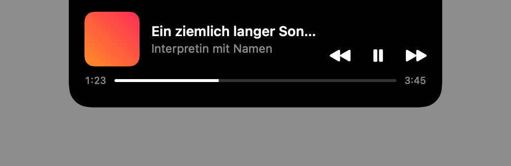

# Gnotchi

**Die Notch zeigt, was gerade läuft. Mit der Maus darüber steuerst du es.**

Kostenlos und quelloffen (MIT). Für macOS 27 auf Macs mit Apple-Chip. Ohne Konto und ohne Nutzungsstatistik.

---

## Warum es Gnotchi gibt

Die Notch am MacBook ist ein schwarzer Fleck mitten in der Menüleiste. Sie tut nichts. Und wenn
beim Arbeiten Musik läuft oder nebenher ein Video, suche ich zum Pausieren jedes Mal erst die App
oder den richtigen Browser-Tab.

Es gibt Notch-Apps, die das lösen. Die meisten wollen aber viel mehr sein und sehen nach eigener
App aus. Ich wollte eine Insel, die so aussieht, als hätte Apple sie gebaut, und sonst nichts tut.

## Was Gnotchi macht

- Läuft Musik oder ein Video, zeigt die Notch klein das Cover und einen Pegel. Auf Bildschirmen
  ohne Notch sitzt dieselbe Insel als Pille oben in der Mitte.
- Bleibt die Maus kurz darauf, klappt sie auf: Titel, Interpret, Zurück, Pause, Weiter und ein
  Fortschrittsbalken zum Spulen.
- Das funktioniert mit Spotify, Musik und mit Videos in Safari, Edge oder Helium. Egal, in
  welchem Fenster sie gerade liegen.
- Über dem Titel steht, welche App spielt. Läuft der Ton woanders, sagt die Insel es dir: „Auf
  anderem Gerät“ bei Spotify Connect, bei AirPlay oder Bluetooth der Name des Lautsprechers.
- Sie drängt sich nicht auf. Ab Werk klappt sie erst nach 0,6 Sekunden auf (einstellbar), fünf
  Sekunden nach dem Pausieren ist sie weg, und bei Vollbild-Apps bleibt sie aus.

## Was sonst noch in der Notch landet

- Diktierst du mit [Tippi](https://github.com/miwixyz/Tippi), steht in der Notch ein rotes
  Mikrofon mit dem Pegel deiner Stimme. Tippis eigene Anzeige bleibt dann weg. Mit Tippis
  Live-Vorschau klappt die Insel auf und zeigt die letzten zwei Zeilen, während du sprichst.
- Ein oranger Punkt heißt: Eine App nutzt das Mikrofon. Grün ist die Kamera. Welche App am
  Mikrofon hängt, siehst du, wenn du mit der Maus darüberfährst.
- Kopfhörer verbunden? Die Notch zeigt drei Sekunden lang ihren Namen.
- Oben rechts in der großen Insel sitzt das Ausgabe-Symbol. Ein Klick, und der Ton kommt aus einem
  anderen Gerät.
- Läuft mehreres gleichzeitig, etwa Musik und Kopfhörer, wechselt die kleine Insel alle vier
  Sekunden. Bleibt die Maus darauf, hält sie an.
- Neuer Titel? Dann wird die Insel drei Sekunden lang breiter und zeigt, was jetzt läuft.
- Hat eine meiner anderen Apps ein Update bereit (Tippi, Kalli, Qotti, Seam), steht es in der
  Notch, bis es installiert ist. Ein Klick, und das Update-Fenster ist offen. Dafür braucht jede
  App eine neue Version. Kalli kommt zuerst.
- Gnotchi merkt sich, was du kopierst, wenn du es einschaltest. ⌃< öffnet am Rand eine Liste mit Suche, in der Notch liegen die letzten Kopien als Kacheln. Was du öfter brauchst, heftest du an oder sortierst es in Sammlungen. Passwörter und Schlüssel kommen in den Tresor, den nur Touch ID öffnet. Deine Sammlungen aus PastePal holst du über einen Import herüber. Ein Doppelklick in der Liste fügt den Eintrag gleich in deine App ein.
- Wer Qotti nutzt, bekommt eine kurze Warnung, wenn das 5-Stunden-Limit von Claude oder Codex
  bei 80 und bei 95 Prozent steht. Im Band steht der Stand dauerhaft.
- Spotify soll in die Notch, Safari aber nicht: Jede Wiedergabe-App hat ihren eigenen Schalter.
- Fünfzehn Minuten vor deinem nächsten Termin steht er in der Notch, mit Uhrzeit und Restzeit. Dafür
  braucht es [Kalli](https://github.com/miwixyz/Kalli) ab 0.12.0.
- Den Timer startest du im Menü, er läuft in der Notch mit. Ist er um, blinkt sie orange, bis du klickst.
- Vor einem Anruf kurz in den Spiegel schauen: Das Kamera-Symbol in der großen Insel zeigt dein Bild.
  Die Kamera ist aus, sobald die Insel zuklappt.
- Groß zeigt die Insel immer nur eine Sache. Was sonst läuft, steht als kleines Symbol darüber. Wer
  mag, heftet sie fest oder lässt sie als schmales Band über die Menüleiste aufgehen.
- Mitteilungen von Apps, die du auswählst, erscheinen in der Notch statt oben rechts, mit ihren Knöpfen. Ein Klick öffnet die App. Ruft dich jemand auf dem iPhone an, nimmst du in der Notch an oder lehnst ab, und Apples Anruf-Fenster bleibt weg. Oder du lässt mitlesen, was der Anrufer auf die Mailbox spricht.
- Wie viele ungelesene Mails und Nachrichten warten, steht im Band. Ein Klick, und die App ist offen.
- Arbeitet Claude Code für dich, siehst du es in der Notch. Ist die Antwort fertig, klappt sie kurz auf. Wartet Claude auf deine Erlaubnis, wird der Punkt gelb. Ein Klick bringt dich zurück zur Sitzung.
- Hinter einem Symbol in der großen Insel steckt das Wetter für deinen Ort, von jetzt bis zum Ende der Woche.
- Zieh eine Datei zur Notch, und sie wartet dort. Dann wechselst du in Ruhe die App oder den Bildschirm und ziehst sie am Ziel wieder heraus. Auf Wunsch packt Gnotchi alles in ein ZIP, auch mit Passwort.
- Machst du ein Bildschirmfoto, wartet es kurz darauf an der Notch, auch das aus CleanShot. Von dort ziehst du es in den Chat oder die Mail und musst es nicht erst auf dem Schreibtisch suchen. Das schaltest du in den Einstellungen ein.
- Läuft gerade nichts, zeigt die kleine Insel die Temperatur oder wie viele Dateien warten.

## Wie von Apple

Tiefschwarz, bündig an der Notch, unten weich gerundet. Systemschrift, Aufbau wie die Wiedergabe
im Kontrollzentrum. In der Notch steht kein Logo und keine eigene Farbe.

## Datenschutz

Gnotchi selbst braucht keine Bedienungshilfen-Freigabe. Es liest keine Fenstertitel und löst keine Eingaben aus. Wer die Mitteilungen einschaltet, gibt die Freigabe einem eigenen kleinen Hilfsprogramm, und nur dem. Es liest Apples Mitteilungen und reicht bloß die der ausgewählten Apps an Gnotchi weiter, nachdem beide geprüft haben, dass der andere echt ist. Fügst du aus der Zwischenablage ein, drückt es ⌘V und sonst keine Taste. Mitteilungstexte werden weder gespeichert noch protokolliert.

Titel, Interpret und Cover bleiben im Arbeitsspeicher deines Macs. Ins Netz geht Gnotchi nur, um nach Updates zu suchen, und, wenn du es einschaltest, für das Wetter. Dorthin geht nur der Ort, den du gewählt hast, nie dein Standort. Im Systemprotokoll steht nicht, was du hörst.

Die Ablage merkt sich nur, wo deine Dateien liegen. Den Inhalt nicht. Ausnahme sind Fotos aus der Fotos-App und Anhänge aus Outlook oder Gmail: Die legt sie als Kopie in einen eigenen Ordner und löscht genau diese Kopie wieder, wenn du den Eintrag entfernst. Sie öffnet nichts, und ein ZIP-Passwort vergisst Gnotchi nach dem Packen. Bei Bildschirmfotos schaut Gnotchi nur nach, ob eine neue Datei eines ist, und merkt sich, wo sie liegt. Das Bild selbst öffnet es nicht.

Für den Hinweis „Auf anderem Gerät“ fragt Gnotchi nur ab, ob eine App gerade Ton ausgibt. Es hört
nichts mit und nimmt nichts auf.

Ob eine App Mikrofon oder Kamera nutzt, erfährt Gnotchi ohne eigene Freigabe. Den App-Namen zeigt es
nur in der Insel, im Protokoll steht er nicht. Von Tippi kommt „nimmt auf“ und der Pegel. Den Text der
Live-Vorschau bekommt Gnotchi nur auf einem geschützten Weg, den andere Programme nicht nutzen können. Deinen
nächsten Termin schickt Kalli auf demselben Weg, und Gnotchi vergisst ihn bei Beginn.

Die Kamera braucht Gnotchi nur für den Spiegel. macOS fragt erst, wenn du ihn zum ersten Mal öffnest.
Das Bild landet nirgends außer auf deinem Bildschirm.

Für ein Update öffnet Gnotchi nur die echte App und prüft vorher ihre Signatur. Die Meldung, die
dafür ankommt, enthält nur ein Kürzel der App und die Versionsnummer.

Von Claude Code erfährt Gnotchi nur, in welchem Projekt gerade gearbeitet wird, ob die Sitzung wartet
und wie die Antwort anfängt. Deine Eingaben und deine Dateien sieht es nicht. Erlauben oder ablehnen
kann Gnotchi nichts, das bleibt bei dir in der Sitzung.

Den Verlauf der Zwischenablage speichert Gnotchi nur verschlüsselt, und den Schlüssel bekommt keine andere App. Kopien aus Passwort-Apps landen gar nicht erst darin. Kopierst du einen API-Schlüssel, zeigt Gnotchi ihn nur als Punkte und löscht ihn nach fünf Minuten wieder. Den Tresor öffnet nur dein Finger oder dein Passwort. Der Verlauf bleibt auf deinem Mac.

Der Code ist offen. Jede dieser Aussagen lässt sich dort und im Sicherheitsentwurf nachprüfen.

## Voraussetzungen

macOS 27 auf einem Mac mit Apple-Chip. Mit Notch am schönsten, ohne Notch läuft es als Pille.
Beim ersten Spulen in Spotify fragt macOS einmal, ob Gnotchi Spotify steuern darf. Dieselbe Frage
kann für Musik kommen, falls macOS den normalen Zugriff auf die Wiedergabe sperrt.

## So bekommst du Gnotchi

Version 0.11.1 gibt es als signierte, von Apple notarisierte App unter
[GitHub-Releases](https://github.com/miwixyz/Gnotchi/releases/latest). Danach aktualisiert sich
Gnotchi selbst, wenn du es erlaubst. Eine Website unter gnotchi.mwlr.dev ist geplant.

---

Gnotchi ist ein Projekt von Michael Wildenauer.
